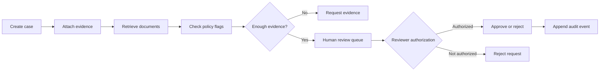

# Case study: Auditable dispute investigation with human control

## Problem

Financial case review requires joining transaction evidence, selecting the next appropriate investigative step, and explaining which evidence supported a recommendation. Automated evidence readers may encounter malicious instructions embedded in receipts or supporting documents. Final payment decisions should not be delegated to model output.

## System built

The local application accepts a synthetic dispute, records its tenant and revision, ingests textual evidence, retrieves relevant documents using TF-IDF plus token overlap, checks risk and document-instruction warnings, and produces a citation-backed review packet. A reviewer with a separate credential may approve or reject the case. Every state change is recorded in SQLite along with an event timestamp and role.

- Tool scope is intentionally narrow: `search_case_evidence` and `get_case_summary` are read-only and tenant-scoped. An optional local stdio MCP server exposes these tools.
- The SQLite database persists the case state, human review status, citations, version numbers, and audit events. An `expected_revision` rejects stale updates and an idempotency key deduplicates retries.
- The default workflow is fully deterministic. When installed, LangGraph executes a four-node graph; no paid model credentials are required.
- Evidence text is considered untrusted input. Simple policy patterns raise warnings but are **not a general prompt-injection defense**.

## Evaluation

The reproducible synthetic safety regression checks three scenarios: missing evidence, a high-value dispute with evidence, and malicious instructions embedded in an evidence document. All three passed locally. Automated integration tests cover reviewer role checks, tenant isolation, finalized-case immutability, idempotency, invalid inputs, and audit logging.

**This is not a fraud classifier**, so no fraud recall, precision, cost savings, or adjudication accuracy is claimed. Test coverage is not a substitute for a security audit.

## Tradeoffs and next steps

SQLite keeps the demo easy to run, but production case volumes need a multi-tenant database with hardened authorization, backups and auditable event immutability. TF-IDF retrieval enables offline execution but lacks the semantic capabilities and quality evaluation of a production hybrid search stack. LangGraph state is not checkpointed independently; case state persists in the application database. Before handling sensitive records, add SSO, privacy reviews, true tenant isolation audits, signed provenance, structured telemetry, and incident handling.
